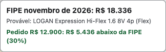
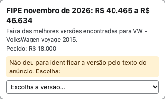
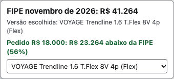

# FIPE no Marketplace e OLX

[](https://github.com/Code-It-Labs/extensao-fipe/actions/workflows/ci.yml)
[](LICENSE)
[](https://github.com/Code-It-Labs/extensao-fipe/releases/latest)

Extensão gratuita e de código aberto que mostra, **dentro do anúncio de carro**, quanto vale o carro na Tabela FIPE do mês e quanto o preço pedido está acima ou abaixo disso. Sem conta, sem anúncios, sem rastreamento.

| Versão provável | Faixa e seletor | Versão escolhida |
|---|---|---|
|  |  |  |
| O texto do anúncio identificou a versão. | O anúncio não diz a versão: o selo mostra a faixa e deixa você escolher. | Depois de escolher, o selo mostra o valor dessa versão. |

Imagens: exemplo real, Chrome 157, novembro/2026 (anúncios reais do Facebook e da OLX).

## O que faz

- Lê o anúncio de carro que você abriu no **Facebook Marketplace** ou na **OLX** (título, ano, preço, ficha do veículo e descrição).
- Identifica a marca, o modelo e a versão mais provável na Tabela FIPE e consulta o valor do mês de referência.
- Mostra um selo no **canto inferior direito** da página com o valor FIPE e a diferença para o preço pedido (em reais e em %).
- Quando o anúncio não deixa clara a versão, mostra a faixa de valores e uma lista para você escolher. A escolha fica salva neste navegador, para aquele anúncio.

## Instalação

A extensão ainda **não está nas lojas** (Chrome Web Store, Firefox Add-ons). Você instala a partir de um arquivo, em poucos minutos.

### Chrome (Edge e Brave devem funcionar do mesmo jeito, mas não foram testados; os nomes dos botões podem variar)

1. Na página de [Releases](https://github.com/Code-It-Labs/extensao-fipe/releases/latest), em **Assets**, baixe o arquivo do Chrome, por exemplo `extensao-fipe-chrome-0.2.0.zip` (o número muda a cada versão). **Não baixe "Source code"**: esse é o código-fonte, não a extensão pronta.
2. Descompacte numa pasta que você **não vai apagar**: o navegador lê a extensão direto dela.
3. Abra `chrome://extensions` (no Edge e no Brave o endereço começa com `edge://` e `brave://`).
4. Ligue o **Modo do desenvolvedor** (fica na página de extensões; o lugar e o nome podem variar entre navegadores).
5. Clique em **Carregar sem compactação** e escolha a pasta descompactada (a que tem o `manifest.json`).
6. Abra um anúncio de carro e aperte **F5**.

Opcional: o arquivo `SHA256SUMS`, na mesma página, serve para conferir se o download veio intacto.

Passo a passo completo, com atualização, remoção e solução de problemas: [INSTALAR.md](INSTALAR.md).

### Firefox 127 ou mais novo (temporária)

1. Na página de [Releases](https://github.com/Code-It-Labs/extensao-fipe/releases/latest), em **Assets**, baixe o arquivo do Firefox, por exemplo `extensao-fipe-firefox-0.2.0.zip` (**não** o "Source code"), e descompacte.
2. Abra `about:debugging#/runtime/this-firefox`.
3. Clique em **Carregar extensão temporária** e escolha o arquivo `manifest.json` da pasta descompactada.
4. Abra um anúncio de carro e aperte **F5**.

**Ela some quando você fecha o Firefox** (extensão temporária). O Firefox só mantém extensões permanentes se elas forem assinadas pela Mozilla, e este pacote não é assinado. Por isso é preciso carregá-la de novo a cada vez que abrir o navegador.

## Como ler o selo

- **Provável**: o texto do anúncio permitiu identificar a versão. O selo mostra o nome da versão FIPE (com o combustível), o valor e a diferença para o preço pedido. Confira se a versão é mesmo a do anúncio. Se o aviso de "confiança baixa" aparecer, há poucas pistas no texto.
- **Faixa de valores**: o anúncio não diz a versão. O selo mostra do menor ao maior valor entre as versões mais prováveis.
- **Escolha a versão**: use a lista do selo para escolher a versão certa e ver o valor dela. Essa escolha fica salva para aquele anúncio, neste navegador.
- **Não encontrei na FIPE**: o selo mostra o que leu (marca, modelo e ano) para você conferir.

## Privacidade

Resumo: a extensão só envia a um serviço público de consulta à FIPE **códigos** de marca, modelo e ano (e, quando a versão não é clara, códigos de modelos parecidos da mesma família; o serviço pode, portanto, inferir a família do carro e o ritmo das suas consultas). Nada do anúncio, do anunciante ou da página (título, descrição, preço, link, nomes) sai do seu navegador. O cache e as versões que você escolhe ficam só no navegador. Não há conta, rastreamento nem anúncios.

Detalhes, permissões e como apagar os dados: [PRIVACY.md](PRIVACY.md).

## Limitações e avisos

- **A FIPE é uma referência, não uma avaliação.** Ela não considera o estado do carro, a quilometragem, a documentação, o histórico nem a região. Preço abaixo da FIPE **não** é garantia de bom negócio (pode haver problema que explique o preço). Confira o carro e o vendedor.
- **O valor é o do mês de referência da FIPE**, que o selo mostra (por exemplo, "FIPE novembro de 2026"). Não é o preço de hoje do mercado.
- **A versão pode estar errada.** O casamento do anúncio com a FIPE é feito pelo texto, e quando o anúncio é vago o selo mostra uma faixa. Se algo estiver errado, [abra uma issue "Carro errado"](https://github.com/Code-It-Labs/extensao-fipe/issues/new/choose).
- **Só carros.** Motos, caminhões e outros anúncios ficam sem selo.
- **Sites suportados:** Facebook Marketplace e OLX. Webmotors e iCarros ainda não são suportadas (o iCarros estava com os classificados desativados quando foi verificado, em novembro/2026).
- **O que foi testado:** Firefox 159 (instalada como extensão temporária) e Chrome for Testing 157 (zip do Chrome descompactado), com anúncios reais do Facebook (Logan 2008 e Voyage 2015) e da OLX (Corolla 2022): no Chrome 157, o selo, a versão salva depois do F5, o popup e o service worker funcionaram. Os testes automáticos (123 passam, 2 são pulados porque consultam a API real) cobrem os leitores de página, o selo e o casamento de modelos. Num conjunto de 263 títulos escritos à mão no estilo dos anúncios (não anúncios reais), o casamento acertou a família do modelo em 99,6% (1 erro conhecido: Range Rover Velar; nos 15 títulos que não deviam casar, nenhum casou); em anúncios reais o resultado pode ser pior.
- **O que NÃO foi testado:** Edge, Brave, Windows, Safari, a OLX em mais de um anúncio no Chrome, e `web.facebook.com` / `m.facebook.com`. Pode funcionar, mas não há confirmação.
- **O Facebook muda o site com frequência** e a extensão lê o texto da página; um dia o selo pode parar de aparecer até alguém ajustar o leitor.
- **A consulta depende de um serviço de terceiros** (`fipe.parallelum.com.br`) que limita as consultas. O limite é do serviço, não da extensão, e não foi confirmado quanto é. A primeira consulta de um modelo novo faz dezenas de chamadas (as seguintes usam o cache), então a extensão pode ficar sem consultar por um tempo. Se der erro de rede ou de limite (429), o selo mostra a mensagem e só tenta de novo quando você recarrega a página (F5). Leia os termos de uso do serviço antes de depender dele.

## Perguntas frequentes

**O selo não aparece. O que faço?** Aperte **F5** na página do anúncio (a extensão só entra quando a página carrega, inclusive se você chegou ao Marketplace clicando num link de outra página do Facebook). Confira se a extensão está ligada, se o anúncio é de **carro** com ano, marca e modelo, e se a mensagem do selo (erro de rede ou de limite) explica o motivo.

**O selo mostrou a versão errada.** Quando o anúncio não diz a versão, o selo mostra uma faixa e uma lista: escolha a versão certa. Se ele afirmou uma versão "provável" errada, confira o carro na [Tabela FIPE oficial](https://veiculos.fipe.org.br/) e [abra uma issue "Carro errado"](https://github.com/Code-It-Labs/extensao-fipe/issues/new/choose).

**Preço abaixo da FIPE é bom negócio?** Não necessariamente. A FIPE é uma referência de mercado: não vê o estado do carro, a quilometragem, a documentação, o histórico nem a região, e um preço muito baixo pode ser sinal de problema (ou de golpe). O selo não é avaliação nem conselho de compra.

**Que dados saem do meu navegador?** Só códigos de marca, modelo e ano (e de modelos parecidos da mesma família) para `fipe.parallelum.com.br`, que também vê o seu IP. Título, descrição, preço, link e dados do anunciante ficam no navegador. Detalhes em [PRIVACY.md](PRIVACY.md).

## Desenvolvimento

JavaScript puro, sem build e sem bibliotecas na extensão. O Node (24.15 ou mais novo) só é usado nos testes e no empacotamento.

```bash
npm install                                      # instala o jsdom, usado só nos testes
npm test                                         # testes offline (usam arquivos de exemplo, sem rede)
FIPE_REAL=1 node --test tests/api-real.test.js   # opcional: testa contra a API real (~25 consultas, gasta a cota diária)
node tools/empacotar.js                          # gera dist/extensao-fipe-chrome-<versão>.zip e dist/extensao-fipe-firefox-<versão>.zip
```

Para testar no navegador sem empacotar: `chrome://extensions` > Modo do desenvolvedor > Carregar sem compactação > escolha a pasta do repositório. Depois de editar, recarregue a extensão **e** aperte F5 na página do anúncio. Mais detalhes em [docs/EMPACOTAR.md](docs/EMPACOTAR.md).

### Estrutura

| Arquivo | Papel |
|---|---|
| `manifest.json` | Manifest V3: permissões, sites e a ordem dos scripts. |
| `src/parser.js` | Texto do anúncio em dados (ano, marca e modelo, preço, combustível, câmbio, cilindrada). Sem DOM. |
| `src/ciclo.js` | Decisão pura do ciclo de 1 s (limpar, aguardar ou consultar). |
| `src/fipe.js` | Cliente da API FIPE, cache e casamento do anúncio com as versões da FIPE. |
| `src/selo-comum.js` | O que é igual em todos os sites: ciclo, pedido ao service worker, desenho do selo e escolha salva. |
| `src/selo.css` | Estilo do selo. |
| `src/content-facebook.js` | Leitor do Facebook Marketplace (único arquivo que conhece o Facebook). |
| `src/content-olx.js` | Leitor da OLX (único arquivo que conhece a OLX). |
| `src/background.js` | Service worker (Chrome) / event page (Firefox): fala com a API FIPE; o content script não pode, por causa do CORS. |
| `src/popup.html`, `popup.css`, `popup.js` | Popup de ajuda ao clicar no ícone. |
| `tests/` | Testes (`node:test`) e arquivos de exemplo (`tests/fixtures/`). |
| `tools/empacotar.js` | Gera os zips do Chrome e do Firefox, em JS puro (sem o comando `zip`). |
| `docs/` | Roteiro de teste manual, guia de empacotamento, limitações conhecidas e ideias (`BACKLOG.md`) e imagens do README. |

### Como adicionar um site novo

Um site novo é **um leitor de página** mais **um bloco no manifest**. O parser, o selo e o cliente FIPE não mudam.

1. Crie `src/content-<site>.js` com um comentário de abertura e, no fim, chame o selo comum:

   ```js
   FipeSelo.iniciar({ site: 'abc', idDaUrl, lerPagina });
   ```

   - `site`: sigla curta do site (`fb`, `olx`...). Prefixa a chave da escolha salva, para ids iguais de sites diferentes não colidirem.
   - `idDaUrl()`: devolve o id do anúncio de carro a partir de `location` (texto) ou `null` se a página atual não é um anúncio de carro.
   - `lerPagina()`: devolve `null` (não é anúncio de carro ou ainda não carregou) ou `{ titulo, preco, sobre, descricao }`, todos textos crus da página. `titulo` no formato `"2015 Volkswagen Voyage ..."`, `preco` com `R$`, `sobre` a ficha do veículo (combustível, câmbio) e `descricao` o texto do vendedor. Ler só por tags e texto, nunca por classes CSS (o HTML dos sites costuma ser ofuscado). Não usar, não guardar e não enviar dados do anunciante.
2. Em `manifest.json`, acrescente um bloco em `content_scripts` com os scripts **nesta ordem**, porque cada um usa o global do anterior:

   ```json
   {
     "matches": ["https://*.exemplo.com.br/*"],
     "js": ["src/parser.js", "src/ciclo.js", "src/selo-comum.js", "src/content-abc.js"],
     "css": ["src/selo.css"],
     "run_at": "document_idle"
   }
   ```

3. Acrescente o teste do leitor (use `tests/content-olx.test.js` e `tests/helper-dom.js` como modelo) e atualize `tests/manifest.test.js`, que confere os `matches` e a ordem dos scripts.
4. Atualize `PRIVACY.md` e este README (sites suportados). Mais detalhes em [CONTRIBUTING.md](CONTRIBUTING.md).

## Contribuindo

Contribuições são bem-vindas, principalmente relatos de carros que o selo identificou errado. Veja [CONTRIBUTING.md](CONTRIBUTING.md). Para falhas de segurança, veja [SECURITY.md](SECURITY.md). Este projeto segue um [Código de Conduta](CODE_OF_CONDUCT.md).

## Aviso legal

Este é um projeto **independente**. Não tem vínculo, patrocínio nem aprovação da FIPE, da Meta/Facebook, da OLX nem do serviço parallelum. FIPE é nome da Fundação Instituto de Pesquisas Econômicas. Os nomes e as marcas citados pertencem aos respectivos donos e aparecem só para dizer com o que a extensão funciona.

**O selo é uma referência, não avaliação nem aconselhamento de compra ou de preço.**

Os valores vêm do serviço público e **não oficial** `fipe.parallelum.com.br`, de terceiros, sem garantia de exatidão, de disponibilidade ou de que correspondam à Tabela FIPE publicada. Para uma decisão importante, confira o valor no site oficial da FIPE. O software é fornecido "como está" e o uso é por sua conta e risco.

## Licença

[MIT](LICENSE) © 2026 Code It Labs.
